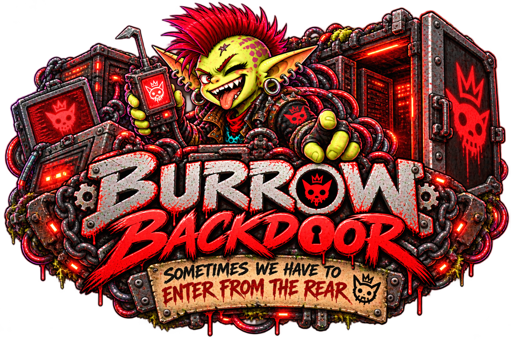

# Burrow Backdoor

*Sometimes we have to enter from the rear.*

A controlled route into the **home Burrow that hosts your agent**. Inspect runtime diagnostics, understand stalled work, and let selected agents manage mods through Core.

[Install Backdoor](installation.md){ .md-button .md-button--primary }
[Explore the tools](tools.md){ .md-button }

!!! danger "Real access. Real consequences."
    Backdoor includes administrative tools that can install, update, enable, disable, and uninstall mods. Grant administration only to agents you trust to make those changes. Global diagnostics can reveal other agents’ activity. Diagnostic results can contain private information even when credentials and large content bodies are excluded. Review and redact results before sharing.

## What it does

- **26 diagnostic tools** for health, sessions, traces, context, run proofs, Brains metadata, Forge, and mods.
- **8 administrative tools** for inventory, refreshing configured sources, mod lifecycle changes, and durable operation status.
- **Two independent access lists**: global diagnostics and administration. Ordinary agents retain caller-scoped diagnostics.
- **Core-owned identity and authority**: tool arguments cannot choose who is making the call.

Backdoor works inside Burrow. There is no separate MCP server, API token, listener, or container to configure. If an agent uses Node Goblin for remote execution, Backdoor still targets its home Burrow, not that remote machine.

## Choose your path

| Goal | Start here |
| --- | --- |
| Set it up | [Install and enable](installation.md) |
| Select trusted agents | [Agent access](access.md) |
| Investigate a stuck session | [Diagnostic workflow](diagnostics.md) |
| Update or disable a mod | [Manage mods](administration.md) |
| Understand a queued or interrupted change | [Operations and recovery](operations.md) |

See the [public source](https://github.com/GoblinKing-Burrow/Burrow-Backdoor), [Burrow guide](https://burrow-docs.blissful-psychosis.com/), and [Node Goblin guide](https://nodegoblin-docs.blissful-psychosis.com/).
